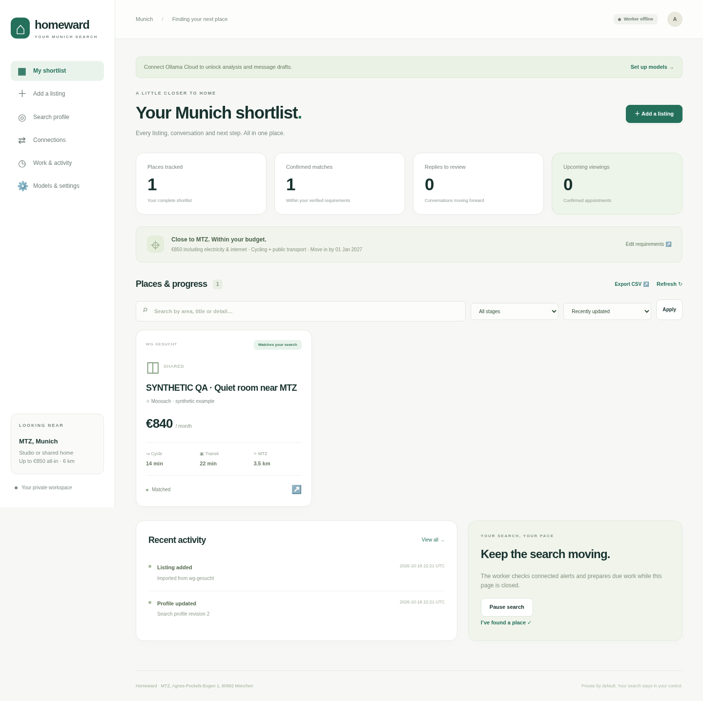

# Homeward · Munich Flat Agent

A small private rental-search workspace built with **LangChain, LangGraph, Ollama Cloud, FastAPI and SQLite**. It remembers listings and conversations, drafts personal messages, schedules a follow-up, and tracks viewings. Closing the website does not stop the separate worker.

The initial search profile accepts studios or shared accommodation, caps **total monthly costs at €850 including electricity and internet**, targets 15 November 2026 with 1 January 2027 as the latest move-in, and compares cycling and public transport within 6 km of MTZ. Every field is editable.

## What works in this release

- Private responsive UI: shortlist, fact review, conversations, viewing records, model settings, job history and connection status.
- SQLite persistence, atomic job claims, expiring leases, consistent tracker backups, deduplication and action history.
- LangGraph listing-extraction workflow with durable SQLite checkpoints; LangChain `ChatOllama` calls the direct Ollama Cloud API.
- GLM/Kimi model routing per stage, cloud capability checks, schema validation, bounded repair/escalation, a daily request ceiling and visible provider failures.
- Pasted listings, `.eml` alert imports and optional read-only SSL IMAP polling with exact allowed senders. Supported direct link patterns: WG-Gesucht, flatsforfriendz, ImmoScout24 and immowelt.
- Draft editing/copying, explicit recording of a manual platform send, incoming replies, one scheduled follow-up draft, viewing conflict checks and CSV/ICS exports.
- Local Cua desktop discovery, Appium status checks, screenshot/UI-source capture from an existing emulator session, and Ollama vision interpretation that proposes a next step.
- macOS setup and login services for the UI, worker and private Appium, with idle-sleep prevention while the worker runs.
- A shared Windows/macOS physical-Android adapter: USB discovery, local screen/control calibration, bounded feed polling, persistent deduplication, automatic enquiries for verified matches, reply capture and optional single follow-up delivery.
- A durable phone-send ledger: exact listing/thread/body checks before a click, outgoing-message evidence before recording delivery, and manual reconciliation after uncertain outcomes.

**Android sending requires a successful owner-calibrated pilot on your installed app.** No Flatsforfriends package/activity/selectors are guessed or supplied as a verified profile. The adapter can send initial enquiries for verified matches and optionally one follow-up; automatic reply acceptance and viewing confirmation are not enabled. Other websites still use manual sending. A challenge or unsupported UI pauses the adapter; this project contains no bot-detection evasion.

**Travel times are entered from a routing source.** This release does not calculate live transit/cycling journeys or geocode addresses. Unknown costs, dates and route distances stay in review. A radius alone is not a verified commute.

## Start on your Windows laptop

Install Python 3.11+. If you downloaded the source ZIP, extract it and open PowerShell in the extracted project folder. Once the source is published, clone the project with Git:

```powershell
git clone https://github.com/malladi2610/housing-agent.git
cd housing-agent
```

Then, from the project folder:

```powershell
.\scripts\check-windows-host.ps1
.\scripts\setup.ps1
.\scripts\start.ps1
```

Open **http://127.0.0.1:8000**. Run these commands on the Windows laptop itself: a chat or Codex window on that laptop can still use a separate cloud execution environment. The launcher starts web and worker as independent local processes. To stop those processes:

```powershell
.\scripts\stop.ps1
```

If local script policy prevents running a script, use the manual Python commands below according to your machine's policy. No system execution-policy change is required by the application.

First-run steps:

1. Open **Models & settings**, save your Ollama Cloud API key locally, and refresh the public cloud catalog. Do not paste a key into GitHub or chat. The key is stored in ignored `data/secrets.json`, or use `OLLAMA_API_KEY` in ignored `.env`.
2. Open **Search profile** and add a truthful introduction, first name, preferred language and viewing availability. Verify the move-in years and distance limit.
3. Add one listing, queue **Analyze listing**, and inspect the facts. Fill in missing costs or verified commute information.
4. Queue **Write a message**, review/edit it, and copy it to the original platform. Save edits before recording a manual send.
5. Record incoming replies and proposed/confirmed viewings. Jobs and failures appear under **Work & activity**.
6. After a bounded pilot, optionally enable automatic alert analysis and draft preparation. Model fallback routes are off by default until explicitly enabled. Messages remain drafts for review.

For phone enquiries, use **Android app** after the device pilot; its enquiry mode is independent of email-only draft preparation. Existing Windows setup/launch scripts continue to work. A physical USB Android phone is supported alongside the emulator option.

## Start on your MacBook with your Android phone

With [Homebrew](https://brew.sh) installed, run in the project folder:

```bash
bash scripts/install-macos-tools.sh
bash scripts/setup-macos.sh
bash scripts/start-macos.sh
```

Open **http://127.0.0.1:8000/android**. Connect the phone by USB, approve debugging on the phone, and use **Check USB phones** to find the actual app/device identifiers. Capture its screen nodes, map the listing/conversation controls, run the read-only pilot, then enable **Send verified matches automatically**. No screenshots are sent to cloud merely by capturing them.

The Mac services restart after a failure and at login. They do not start before login; the worker prevents idle sleep, but the lid must remain open and the phone available. Read [the MacBook + Android setup and Windows-to-Mac migration guide](docs/MACOS.md) for the full calibration procedure, limits and recovery. Stop services with `bash scripts/stop-macos.sh`.

The connected Ollama account is not included. Live cloud inference needs your valid key and model access. The current assignments are candidates, not benchmarked winners for your data:

| Stage | Primary | Configured alternative |
| --- | --- | --- |
| Listing extraction | `glm-5.3-flash` | `glm-5.3` |
| Personal messages | `kimi-k3` | `glm-5.3-flash` |
| Complex replies | `glm-5.3` | `kimi-k3` |
| Screenshots | `kimi-k3` | `glm-5.3-flash` |

Ollama Cloud currently does not offer enforced JSON-schema outputs. The application validates JSON with Pydantic and then applies ordinary Python rules. Model confidence alone never verifies a price or confirms a viewing. Direct API identifiers come from [Ollama's cloud catalog](https://ollama.com/api/tags); downloadable Qwen models are not assumed to be cloud-hosted.

## Manual Python setup / Linux VM

With [uv](https://docs.astral.sh/uv/) installed:

```bash
uv sync --frozen --extra test
cp .env.example .env
uv run flat-agent web
```

In another terminal, in the same directory:

```bash
uv run flat-agent worker
```

Without uv, install it in a virtual environment and use its locked installation:

```powershell
py -3 -m venv .venv
.\.venv\Scripts\python.exe -m pip install uv
.\.venv\Scripts\python.exe -m uv sync --frozen --extra test
.\.venv\Scripts\python.exe -m flat_agent.cli web
# In a second terminal:
.\.venv\Scripts\python.exe -m flat_agent.cli worker
```

For the planned private OS, provision a Linux desktop VM on the Windows laptop. Run these Python services, a dedicated browser and Cua inside it. Start with about 6 GB guest RAM and 4 GB for one Android virtual device, then measure actual usage. Keep the accelerated Android Emulator on the Windows host. These allocations are estimates; this repository does not provision the VM or change Windows settings automatically.

## Docker option

Copy `.env.example` to `.env` and set a strong `FLAT_UI_PASSWORD` in that local file. Then:

```bash
docker compose up --build -d
```

Visit http://127.0.0.1:8000 and sign in as **owner** with that password. Web and worker share a persistent named volume. `docker compose down` retains it; `down -v` deletes it. Docker provides the worker/UI runtime; it does not supply the graphical desktop or Android emulator.

## Saved-search email ingestion

Create saved searches on the platforms and direct their alerts to a dedicated mailbox/folder. Configure these in ignored `.env`, then restart the worker:

```dotenv
FLAT_IMAP_HOST=your.mail.server
FLAT_IMAP_PORT=993
FLAT_IMAP_USER=your-alert-account
FLAT_IMAP_PASSWORD=your-mail-app-password
FLAT_IMAP_FOLDER=RentalAlerts
FLAT_IMAP_SENDERS=exact-alert-sender@example.com,another-verified-sender@example.com
FLAT_IMAP_POLL_SECONDS=180
```

Use actual verified sender addresses; no guessed platform senders are built in. IMAP uses SSL, selects the folder read-only, and fetches with `BODY.PEEK[]`. UIDVALIDITY plus UID tracks ingestion. The latest 100 messages in the selected folder are checked per poll; import older `.eml` files manually. An address allowlist is not cryptographic sender verification: all email contents remain untrusted input.

Tracking redirects are not fetched. A recognized listing URL in a reply notification can attach that notification to an existing thread and cancel follow-up work; the excerpt is clearly labeled and is not a substitute for the complete platform conversation. Paste the full reply before agreeing to a viewing. There is no full platform-inbox sync; calibrated Android reply checks are bounded to contacted ads reachable in the feed.

## Android and Cua pilot

Use a physical USB Android phone on macOS or Windows, or the Android SDK Emulator with hardware acceleration verified on its host. Install/sign into the intended app normally. The phone must remain attached and available while monitoring; using your personal phone in another app pauses that path.

See [MacBook + Android](docs/MACOS.md) or [Windows deployment](docs/WINDOWS.md). The calibrated Android adapter executes bounded navigation and verified enquiries. Cua and vision interpretation remain inspection/proposal tools; website sending is still manual.

## Persistence, access and recovery

- `data/tracker.sqlite3`: listings, profile, messages, jobs, model-call counters and audit events.
- `data/checkpoints.sqlite3`: LangGraph workflow checkpoints.
- `data/secrets.json`: optional local Ollama credential; plaintext protected by local file access, **not encrypted storage**. Use the environment instead if preferred; use disk encryption/appropriate Windows ACLs for the machine.
- `data/screens/`: uploaded/captured private screenshots and optional UI source. Delete screenshots you no longer need. No screenshot is sent to cloud until you request interpretation.
- `data/tracker.sqlite3` also stores native ad identities, the phone lease and delivery intents/receipts. An uncertain send blocks further phone delivery until reconciled. Phone connection settings and calibration remain local; secrets and private runtime data are ignored by Git.
- The UI defaults to loopback. Remote access requires `FLAT_UI_PASSWORD`; use private networking or authenticated HTTPS. Do not expose raw Appium, ADB, Cua or Ollama keys publicly.
- Mutating forms and APIs require CSRF tokens; no cross-origin API access is enabled. UI/API responses never return the Ollama credential.
- Worker heartbeats expire visibly. A stopped worker preserves its queue; an expired job lease can be recovered. Failures remain visible for a deliberate retry rather than looping indefinitely.
- One follow-up draft is due after the configured delay and during Europe/Berlin contact hours. Replies, closure or viewing progress cancel it. Draft generation also rechecks conversation state after a model call.
- The daily model-call ceiling counts attempts, repairs and alternatives. It is a request limit, not a bill guarantee. Auth/quota errors pause cloud work until resolved and cleared in Settings.

Make a consistent tracker backup:

```bash
uv run flat-agent backup /path/to/private-backup.sqlite3
```

To restore, stop web/worker, keep a copy of the current data, and replace the tracker database with the backup. Remove stale `tracker.sqlite3-wal`/`-shm` files only while all processes are stopped. Keep credentials separately. Graph checkpoints may be backed up independently while stopped; the tracker and pending jobs remain the source of truth. Test restore before relying on long-term unattended operation.

For 24/7 macOS operation, the supplied login services restart the processes and keep an idle-sleep assertion while the worker runs. Windows still needs a reviewed startup task/power configuration. Verify recovery after reboot/login, host screen lock and loss of network. A healthy web process does not prove the phone or app is working.

## Tests and learning the code

```bash
uv run pytest -q
```

Tests use fake model/device responses; no real account, API charge or outgoing platform message is required. CI runs on Linux, Windows and macOS. Tests cover physical-device selection, exact W3C Unicode input, send-intent recovery, changed ads/replies, phone leases and launchd definitions. Inspect [the architecture walkthrough](docs/ARCHITECTURE.md) to see how n8n concepts map to LangChain/LangGraph and ordinary Python.

The full planning notes are in [PROJECT_PLAN.md](PROJECT_PLAN.md). The design example under `config/` is documentation; active assignments live in the private tracker settings and are editable in the UI.

## UI preview

This screenshot uses an explicitly synthetic QA listing, not a live rental offer.


