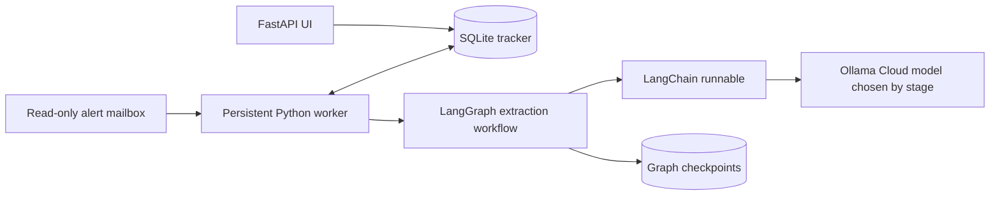

# How the agent works

The application has two processes and one durable tracker:

## From n8n to this project

| n8n concept | Here |
| --- | --- |
| Trigger | UI queues an action; worker periodically queues an IMAP poll |
| Node | A Python function, LangGraph node or connector |
| Data passed between nodes | Typed `WorkflowState` and Pydantic models |
| IF/filter node | `matching.evaluate()` and explicit Python conditions |
| AI node | `ChatOllama` composed with `StrOutputParser` in `llm.py` |
| Workflow execution history | Jobs, events, model-call counters and graph checkpoints |
| Wait/resume | Durable `due_at` jobs; LangGraph checkpoints resume interrupted analysis |
| Credential | Backend environment or ignored local secret file |

LangChain is used for model invocation and message composition. It does not poll websites or act as the scheduler. LangGraph runs the listing extraction/validation sequence and checkpoints it. The tracker stores shared facts and conversations across jobs/models.

## Follow one listing

1. `Store.add_listing()` normalizes the input and deduplicates its source ID. Unknown costs/locations stay unknown.
2. `matching.evaluate()` applies the user's all-in rent, accommodation, date and verified-distance constraints.
3. An `analyze` job is atomically claimed by the worker. The LangGraph `extract` node calls the configured GLM model through LangChain.
4. Pydantic rejects malformed output. Evidence checks and manual-field protection are applied before storing inferred fields. Ordinary Python recalculates eligibility.
5. A `draft` job uses approved profile facts and listing context to ask Kimi for a short message. The result is a draft, not a send.
6. The owner copies/sends on the platform and records the exact saved text. A follow-up job is persisted with its due time.
7. An incoming reply invalidates pending drafts and cancels queued follow-ups. The reply model may propose a response; ambiguous dates and document requests require owner input.
8. Viewings are proposed or explicitly confirmed, with confirmation evidence and a conflict/travel-buffer check. The search continues until marked complete.

## Why there is no unlimited autonomous loop

Each job has a bounded unit of work. Jobs persist between wakes, so the worker can idle without keeping an LLM busy. Model output has no authority to change the profile, open arbitrary tools or certify a delivery. More capable models still need fact and action validation.

Read `models.py`, `matching.py`, `llm.py`, `workflows.py`, and `worker.py` in that order. `db.py` owns transactions; `web.py` owns the user-facing actions. `connectors.py` intentionally stops at inspection until a real-account pilot establishes a permitted delivery path.
